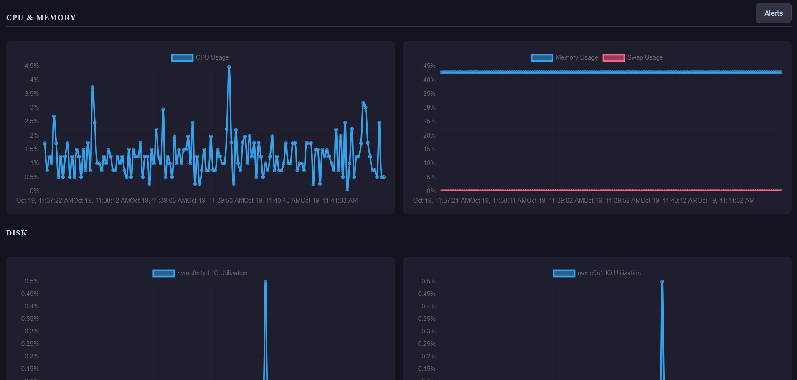

[](https://github.com/kllimenkoo/monitord-aws/actions/workflows/test.yml)

# monitord-aws

A real-time Linux system monitoring dashboard deployed on AWS using Infrastructure as Code (CDK).

A daemon runs on an EC2 instance, collects CPU, memory, disk and network metrics every 2 seconds, and writes them to DynamoDB. A FastAPI Lambda serves the data via HTTP API Gateway. A static frontend hosted on S3 + CloudFront polls the API and renders live charts.


---

## Architecture

```
EC2 (t3.micro)
  └─ monitord daemon (Python, asyncio)
       ├─ collects: CPU, RAM, disk I/O, network throughput
       ├─ detects anomalies → writes alerts
       └─ writes to DynamoDB (7 tables)

DynamoDB
  ├─ cpu_metrics, ram_metrics, disk_metrics, net_metrics
  ├─ alerts
  └─ known_devices, known_interfaces

Lambda (Python 3.12, FastAPI + Mangum)
  └─ reads from DynamoDB
  └─ exposed via HTTP API Gateway

S3 + CloudFront
  └─ static frontend (HTML/CSS/JS, Chart.js)
  └─ config.js injected at deploy time with the API URL
```

All infrastructure is defined in a single CDK stack (`monitord_aws/monitord_aws_stack.py`).

---

## Stack

| Layer            | Service                         |
| ---------------- | ------------------------------- |
| IaC              | AWS CDK (Python)                |
| Compute (daemon) | EC2 t3.micro, Amazon Linux 2023 |
| Compute (API)    | AWS Lambda (Python 3.12)        |
| API              | HTTP API Gateway                |
| Database         | DynamoDB (on-demand)            |
| Frontend hosting | S3 + CloudFront                 |
| Daemon storage   | S3 (daemon code synced at boot) |

---

## Project structure

```
monitord-aws/
├── daemon/               # EC2 daemon
│   ├── daemon.py         # main loop, metric collectors
│   ├── anomaly.py        # anomaly detection, alert writes
│   ├── storage.py        # DynamoDB reads and writes
│   ├── models.py         # dataclasses
│   ├── readers.py        # low-level /proc readers
│   ├── compute.py        # CPU/RAM reading logic
│   └── requirements.txt
├── lambda/               # Lambda API
│   ├── api.py            # FastAPI routes
│   ├── storage.py        # DynamoDB reads
│   ├── schemas.py        # Pydantic response models
│   └── requirements.txt
├── frontend/             # Static dashboard
│   ├── index.html
│   ├── script.js         # Chart.js charts, polling loop
│   └── styles.css
├── monitord_aws/
│   └── monitord_aws_stack.py   # CDK stack
├── scripts/
│   └── install_daemon.sh       # EC2 user data script
└── tests/
```

---

## Deploy

### Prerequisites

- AWS CLI configured (`aws configure`)
- CDK installed (`npm install -g aws-cdk`)
- Python 3.12+, a virtualenv with `pip install -r requirements.txt`
- Docker (used by CDK to bundle the Lambda)

### Bootstrap (once per account/region)

```bash
cdk bootstrap
```

### Deploy

```bash
cdk deploy
```

CDK will output two URLs:

```
MonitordAwsStack.ApiUrl = https://...execute-api.eu-north-1.amazonaws.com/
MonitordAwsStack.DashboardUrl = https://...cloudfront.net
```

Open the `DashboardUrl` in a browser. The EC2 daemon starts automatically on boot — data appears within ~30 seconds.

### Teardown

To tear down the project, run:

```bash
cdk destroy
```

This deletes all DynamoDB tables, S3 buckets (daemon and frontend), EC2 instance, Lambda function, and API Gateway.

The CDK bootstrap resources (`CDKToolkit` CloudFormation stack and its S3 assets bucket) are not managed by this stack and persist after `cdk destroy`. To fully clean up:

```bash
aws s3 rb s3://cdk-hnb659fds-assets-<your-account-id>-eu-north-1 --force
aws cloudformation delete-stack --stack-name CDKToolkit
aws cloudformation wait stack-delete-complete --stack-name CDKToolkit
```

To redeploy after a full cleanup:

```bash
cdk bootstrap
cdk deploy
```

---

## How the daemon works

The daemon runs four async collectors (CPU, RAM, disk, network) in a `TaskGroup`, each writing to DynamoDB every 2 seconds. A separate anomaly checker runs on the same loop, reads recent windows of each metric, and fires an alert to DynamoDB when the short-window average significantly exceeds the long-window baseline.

---

## How the frontend works

`config.js` is generated at deploy time by CDK with the API Gateway URL injected as `window.apiUrl`. On load, the dashboard fetches device/interface names to know which disk and network charts to render, then polls all endpoints every 2 seconds to update the charts.
